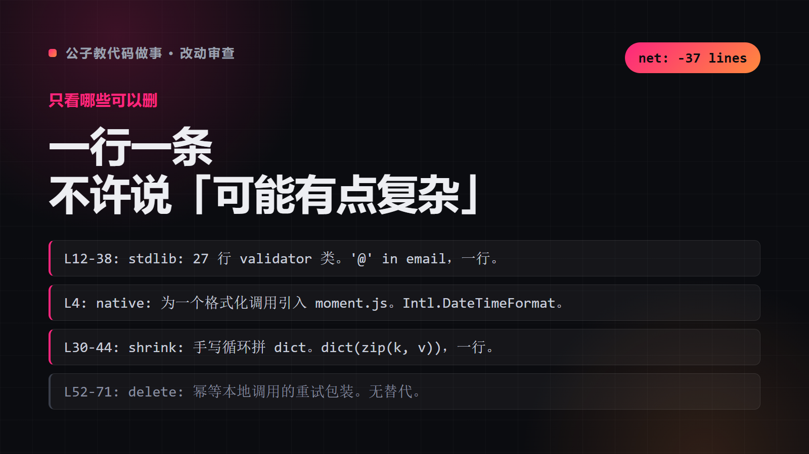

中文 | [English](README.en.md)

# 公子教代码做事 · 改动审查

一个 agent 技能，专门审查**过度设计**：一次改动里哪些代码是可以删的。一行一条，位置 + 该砍什么 + 用什么替代，结尾给一个总数——这次改动还能少几行。

它不管正确性 bug、安全和性能，那是普通 review 的活。它只回答一个问题：**这段代码里有多少是不该写的。**



## 为什么有它

AI 写代码的毛病不是写错，是写多。多一个抽象、多一层包装、多一个只有一个实现的接口——单看都「挺合理」，攒起来就是维护成本。

普通 code review 会顺口说一句「这里是不是有点复杂」，然后你回一句「以后可能要扩展」，这事就过去了。这个技能不给「可能」留位置：每条都必须写出**用什么替代**。写不出替代方案，就不许提。

## 它做什么

1. 扫一遍这次 diff
2. 每条问题打一个标签：`delete:` / `stdlib:` / `native:` / `yagni:` / `shrink:`
3. 一行一条，格式 `<行号>: <标签> <砍什么>. <用什么替代>.`
4. 结尾一行 `net: -N lines possible.`

没得砍就说一句 `Lean already. Ship.` 然后闭嘴。

## 五个标签

| 标签 | 针对什么 | 替代方案 |
|---|---|---|
| `delete:` | 死代码、没人用的灵活性、投机功能 | 什么都不用，删掉 |
| `stdlib:` | 手写标准库早就有的东西 | 指名那个函数 |
| `native:` | 依赖或代码在做平台已经做的事 | 指名那个能力 |
| `yagni:` | 只有一个实现的抽象、没人设的配置、只有一个调用方的层 | 内联，等第二个出现再说 |
| `shrink:` | 逻辑一样，行数更少 | 写出更短的形式 |

## 长什么样

```
❌ "这个 EmailValidator 类可能比必要的复杂一些，你考虑过现阶段是否
   真的需要这么多校验规则吗？"

✅ L12-38: stdlib: 27 行 validator 类。'@' in email，一行，
   真正的校验是确认邮件。

✅ L4: native: 为了一个格式化调用引入 moment.js。
   Intl.DateTimeFormat，0 依赖。

✅ repo.py:L88: yagni: 只有一个实现的 AbstractRepository。
   内联，等第二个出现再说。

✅ L30-44: shrink: 手写循环拼 dict。
   dict(zip(keys, values))，一行。
```

## 安装

```bash
git clone https://github.com/chengangrun-ai/gongzi-teaches-code-review.git \
  ~/.workbuddy-ai/skills/gongzi-teaches-code-review
```

Claude Code 用户把目录放到 `~/.claude/skills/` 下即可。**没有依赖，不用 pip install**，一个 `SKILL.md` 就是一个技能。

## 用法

改完代码说一句：

```
/ponytail-review
```

或者直接说「帮我看看这次改动有没有过度设计」「这段代码能不能少写」。

## 边界

- 只管复杂度。正确性 bug、安全、性能不在范围内，走普通 review。
- 只列清单，不动你的代码。
- 一个 smoke test 或 `assert` 自检不算膨胀，别指望它帮你删测试。
- 想退出：说「正常模式」或 `stop ponytail-review`。

## 致谢

基于 [Ponytail](https://github.com/DietrichGebert/ponytail)（MIT，作者 DietrichGebert）改写，保留了原作者的版权声明（见 `LICENSE`）。

## License

MIT. See [LICENSE](LICENSE).

Made by [公子](https://github.com/chengangrun-ai).
